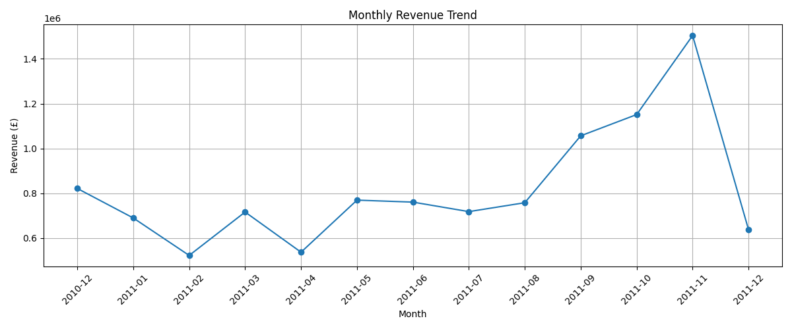
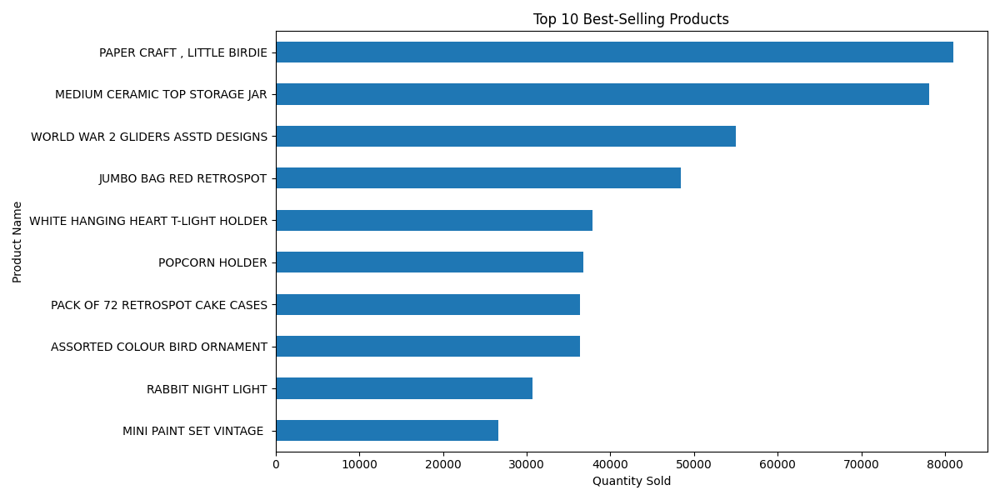
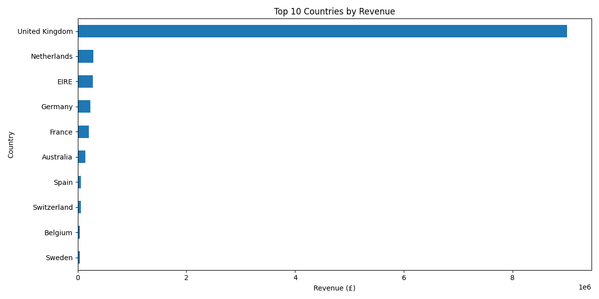
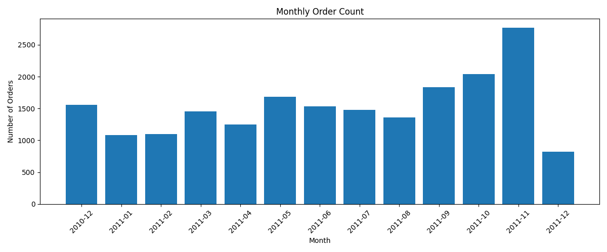
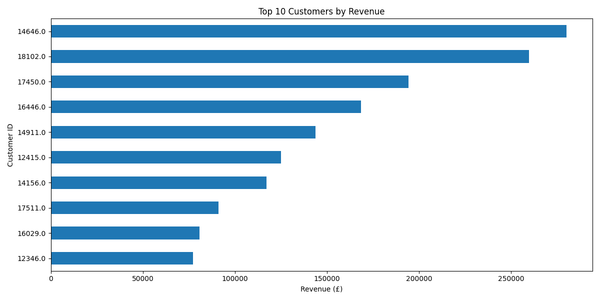

# E-commerce Customer Behaviour Analysis

## Project Overview

This project focuses on analysing e-commerce customer purchasing behaviour using the Online Retail dataset. The main aim is to understand sales performance, customer activity, popular products and country-wise revenue.

The project uses Python for data cleaning and exploratory data analysis (EDA), and Power BI for creating an interactive dashboard.

## Project Objectives

- Analyse customer purchasing behaviour.
- Identify popular and high-revenue products.
- Understand monthly sales and order trends.
- Analyse revenue generated by different countries.
- Create an interactive Power BI dashboard.
- Provide useful business insights and recommendations.

## Dataset Information

**Dataset:** Online Retail

**Source:** [UCI Machine Learning Repository – Online Retail](https://archive.ics.uci.edu/dataset/352/online+retail)

- Original records: 541,909
- Original attributes: 8
- Period: December 2010 to December 2011
- Data type: Transactional retail data

The dataset contains invoice numbers, product codes, product descriptions, quantities, invoice dates, unit prices, customer IDs and countries.

## Technologies Used

- Python
- Pandas
- Matplotlib
- Google Colab
- Microsoft Power BI
- Git and GitHub
- Jupyter Notebook

## Project Structure

```text
Ecommerce-Customer-Behaviour-Analysis/
│
├── dataset/
│   ├── Online Retail.xlsx
│   └── cleaned_online_retail.csv
│
├── notebooks/
│   └── Ecommerce_Customer_Behaviour_Analysis.ipynb
│
├── visualizations/
│   ├── country_revenue.png
│   ├── monthly_orders.png
│   ├── monthly_revenue.png
│   ├── top_customers.png
│   └── top_products.png
│
├── powerbi/
│   └── Ecommerce_Customer_Behaviour_Dashboard.pbix
│
├── README.md
└── .gitignore
```

## Data Cleaning and Preparation

The original dataset was inspected and cleaned using Python and Pandas.

The following operations were performed:

1. Removed duplicate records.
2. Removed cancelled invoices beginning with the letter C.
3. Removed transactions with zero or negative quantities.
4. Removed transactions with zero or negative unit prices.
5. Removed records with missing product descriptions.
6. Created a new column called `TotalAmount` using Quantity × UnitPrice.

Missing CustomerID values were retained for overall sales analysis but excluded from customer-specific analysis.

After cleaning, the dataset contained **524,878 rows and 9 columns**.

## Exploratory Data Analysis (EDA)

The following analyses were performed:

- Dataset structure and data types.
- Missing value analysis.
- Duplicate record analysis.
- Descriptive statistics.
- Total revenue and order analysis.
- Product-wise sales analysis.
- Country-wise revenue analysis.
- Monthly revenue and order trends.
- Customer-wise revenue analysis.
- Correlation and outlier analysis.

Large quantity values were reviewed as potential bulk purchases and were not automatically removed.

## Key Project Results

| Metric | Result |
|---|---:|
| Total Revenue | £10,642,110.80 |
| Total Orders | 19,960 |
| Identified Customers | 4,338 |
| Unique Products | 3,922 |
| Countries | 38 |
| Average Order Value | £533.17 |

*These metrics are calculated from the cleaned positive-sales records. Revenue is calculated as Quantity × UnitPrice.*

## Data Visualizations

### 1. Monthly Revenue Trend



### 2. Top 10 Products by Revenue



### 3. Top 10 Countries by Revenue



### 4. Monthly Order Count



### 5. Top 10 Customers by Revenue



## Power BI Dashboard

An interactive Power BI dashboard was created to present the important business metrics and sales trends.

The dashboard includes:

- Total Revenue KPI.
- Total Orders KPI.
- Total Customers KPI.
- Monthly Revenue Trend.
- Top 10 Products.
- Top 10 Countries by Revenue.
- Monthly Orders.
- Year and Country slicers.

**Dashboard file:** `powerbi/Ecommerce_Customer_Behaviour_Dashboard.pbix`

Open the PBIX file using Microsoft Power BI Desktop to explore the dashboard.

## Business Insights

1. The United Kingdom generated approximately £9 million in revenue and is the largest market.
2. The United Kingdom contributed approximately 84.6% of total cleaned revenue.
3. PAPER CRAFT, LITTLE BIRDIE was the highest-selling product by quantity, with 80,995 units.
4. The analysis identified 4,338 customers with available CustomerID values.
5. The business recorded sales across 38 countries.
6. The average order value was approximately £533.17.

## Business Recommendations

1. Maintain sufficient stock of frequently purchased products to meet customer demand.
2. Focus on international marketing opportunities in Germany, France and the Netherlands.
3. Use customer purchasing patterns to develop targeted offers and improve customer engagement.
4. Monitor monthly revenue and order trends to support inventory and sales planning.

## Conclusion

This project helped analyse e-commerce transaction data and understand customer purchasing behaviour. Python was used for data cleaning, analysis and visualization, while Power BI was used to create an interactive dashboard.

The analysis provided useful information about revenue, products, customers and international markets. These findings can help businesses make better decisions and improve sales performance.

## Dataset Reference and License

Chen, D. (2015). *Online Retail*. UCI Machine Learning Repository.

https://doi.org/10.24432/C5BW33

Dataset license: Creative Commons Attribution 4.0 International (CC BY 4.0).

**Note:** This license applies to the original dataset. The project analysis and visualizations were created as part of an academic internship assignment.
